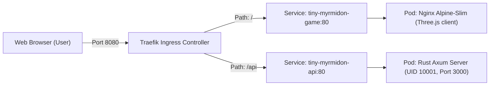

# Tiny Myrmidon

A lightweight 3D Greek survival arena game built with Three.js, backed by a hardened Rust (Axum) leaderboard REST API, and deployed on a local Kubernetes (`k3d`) cluster.

---

## Features

- **3D Arena (`game/`)**:
  - Browser-based Three.js arena with circular Doric peristyle columns.
  - Orbital Aegis shield upgrade that circles the hero and damages nearby foes.
  - Wave progression with 3 enemy archetypes: Trojan Minions, agile Harpies, and Cyclops Bosses.
  - Olympian blessings modal on level-up (built with XSS-safe DOM APIs) and real-time HP/XP HUD.
- **Hardened Leaderboard API (`api/`)**:
  - High-performance REST service written in Rust with Axum and Tokio.
  - Thread-safe in-memory state (`Arc<RwLock<Vec<ScoreEntry>>>`) with automatic top-50 sorting and truncation.
  - **AppSec protections**: wave-plausibility anti-cheat bounds, Unicode character-count validation, control-character filtering, strict origin/method CORS policy, and sliding-window rate limiting (`429 Too Many Requests`).
  - Structured JSON logging via `tracing` and graceful shutdown (`SIGINT`/`SIGTERM`).
- **Cloud-Native & Hardened Deployment (`k8s/`)**:
  - Unified Kubernetes manifest ([k8s/app.yaml](k8s/app.yaml)) with Deployments, Services, and Traefik Ingress on port `8080`.
  - Minimalist Alpine container images (< 20 MB footprint constraint).
  - **Container hardening**: non-root execution (`UID 10001`), `readOnlyRootFilesystem: true`, `allowPrivilegeEscalation: false`, `capabilities.drop: ["ALL"]`, and explicit CPU/memory limits.
- **DevSecOps & CI/CD**:
  - 20 automated tests (8 unit tests + 12 HTTP integration tests covering anti-cheat, CORS, rate limiting, and leaderboard bounds).
  - 3-job GitHub Actions CI pipeline ([.github/workflows/ci.yml](.github/workflows/ci.yml)) enforcing formatting, Clippy, RustSec CVE auditing (`cargo audit`), Kubernetes security policies, and frontend XSS checks.
  - Streamlined developer orchestration via a root [Makefile](Makefile).

---

## Architecture Overview



For complete technical specifications, see [docs/architecture.md](docs/architecture.md).

---

## Quickstart

### Prerequisites
- **Docker** (running daemon)
- **k3d** (v5.x+)
- **kubectl**
- **Rust & Cargo** (1.80+)
- **Make**

### 1-Command Local Setup & Deployment
Run the following command from the repository root:
```bash
make deploy
```

This single command will:
1. Build the minimalist Alpine Docker images for both `api` and `game`.
2. Provision or start the local `k3d` cluster `tiny-myrmidon` with port `8080` bound to the Ingress load balancer.
3. Import Docker images directly into the k3d nodes without an external registry.
4. Apply the unified Kubernetes manifest, restart deployments to load the fresh `:v1` images, and wait for rollout completion.

### Access the Application
- **3D Game Client:** [http://localhost:8080/](http://localhost:8080/)
- **API Health Check:** [http://localhost:8080/api/health](http://localhost:8080/api/health)
- **Hero Leaderboard:** [http://localhost:8080/api/scores](http://localhost:8080/api/scores)

---

## Game Controls & Mechanics

| Control | Action |
| :--- | :--- |
| `W` / `Z` / `Up Arrow` | Move North |
| `S` / `Down Arrow` | Move South |
| `A` / `Q` / `Left Arrow` | Move West |
| `D` / `Right Arrow` | Move East |
| Auto-Aim | Spears automatically target the closest threat within range |

### Olympian Blessings (Upgrades)
- **Spear of Achilles:** +25% Attack Speed.
- **Hoplite Salvo:** +1 Simultaneous Spear thrown.
- **Sandals of Hermes:** +20% Movement Speed.
- **Forged Bronze:** +1 Damage per impact.
- **Athena's Aegis:** +30 Max HP and immediate full heal.
- **Orbital Shield:** Spawns a rotating brass aegis barrier crushing nearby enemies.

---

## Developer Commands (`Makefile`)

| Command | Description |
| :--- | :--- |
| `make help` | Display all available targets with explanations |
| `make check` | Run formatting check, Clippy linter (`-D warnings`), full 20-test suite, and Kubernetes manifest validation |
| `make test` | Execute unit and in-memory HTTP integration tests |
| `make fmt` | Automatically format all Rust source files |
| `make build` | Build both minimal Alpine Docker images locally |
| `make deploy` | Build, import images, deploy manifests, restart pods, and verify rollout status |
| `make status` | Display the status of all pods, services, and ingress rules |
| `make logs` | Tail live logs from the API pod |
| `make k3d-up` | Provision or start the local `tiny-myrmidon` k3d cluster |
| `make k3d-down` | Tear down and delete the local k3d cluster |
| `make tunnel` | Launch secure mobile tunnel with auto-generated QR code (Ctrl+C to stop) |

---

## Project Structure

```text
tiny-myrmidon/
├── .github/
│   └── workflows/
│       └── ci.yml            # CI pipeline (Rust quality, DevSecOps audit, Docker/K8s checks)
├── api/                      # Rust Axum REST backend
│   ├── src/
│   │   ├── main.rs           # Server entrypoint & graceful shutdown
│   │   ├── lib.rs            # Router, CORS layer & sliding-window rate limiter
│   │   ├── handlers.rs       # HTTP route handlers with structured tracing
│   │   └── models.rs         # Score models & anti-cheat bounds validation
│   ├── tests/
│   │   └── api_tests.rs      # In-memory HTTP integration & security tests
│   ├── Cargo.toml            # Rust dependencies & release profile
│   ├── Cargo.lock            # Deterministic dependency lockfile audited by cargo-audit
│   └── Dockerfile            # Multi-stage Alpine build (< 20 MB, UID 10001)
├── game/                     # Three.js 3D frontend
│   ├── js/                   # Modular WebGL game engine, HUD & XSS-safe upgrade cards
│   ├── styles/               # Game UI & modal stylesheets
│   ├── index.html            # Entrypoint HTML & HUD layout
│   └── Dockerfile            # Nginx alpine-slim static server
├── k8s/
│   └── app.yaml              # Hardened Deployments, Services, and Ingress
├── docs/
│   ├── architecture.md       # In-depth architectural & system design
│   └── api.md                # REST API specification & curl examples
├── scripts/
│   └── tunnel.sh             # Cloudflare tunnel launcher with auto QR code for mobile
├── Makefile                  # Developer task automation
├── AGENTS.md                 # Universal AI agent instructions & coding rules
└── README.md                 # Project documentation
```

---

## REST API Summary

For full request/response schemas and curl examples, refer to [docs/api.md](docs/api.md).

- `GET /api/health` — Service readiness probe.
- `GET /api/scores` — Returns top 50 scores sorted descending.
- `POST /api/scores` — Submits a new score `{ "player_name": string, "score": number, "wave": number }` (validated against anti-cheat bounds and rate-limited to 10 submissions per 10 seconds).

---

## Quality Assurance & DevSecOps CI/CD

Continuous Integration is enforced on every commit and pull request via 3 parallel GitHub Actions jobs:
1. **Rust Code Quality & Tests:** `cargo fmt --check`, `cargo clippy --all-targets -- -D warnings`, and `cargo test --all` (20 unit & HTTP integration tests).
2. **DevSecOps Security Audit:**
   - `cargo audit` scanning `api/Cargo.lock` against the RustSec advisory database.
   - Automated policy enforcement verifying `runAsNonRoot`, `readOnlyRootFilesystem`, `allowPrivilegeEscalation: false`, `capabilities.drop: ["ALL"]`, and resource limits in `k8s/app.yaml`.
   - Static frontend check preventing unescaped `innerHTML` interpolations.
3. **Docker Image & Manifest Checks:** Multi-stage Alpine builds, image size inspection, `docker inspect` verification of non-root user `10001`, and YAML schema validation.
