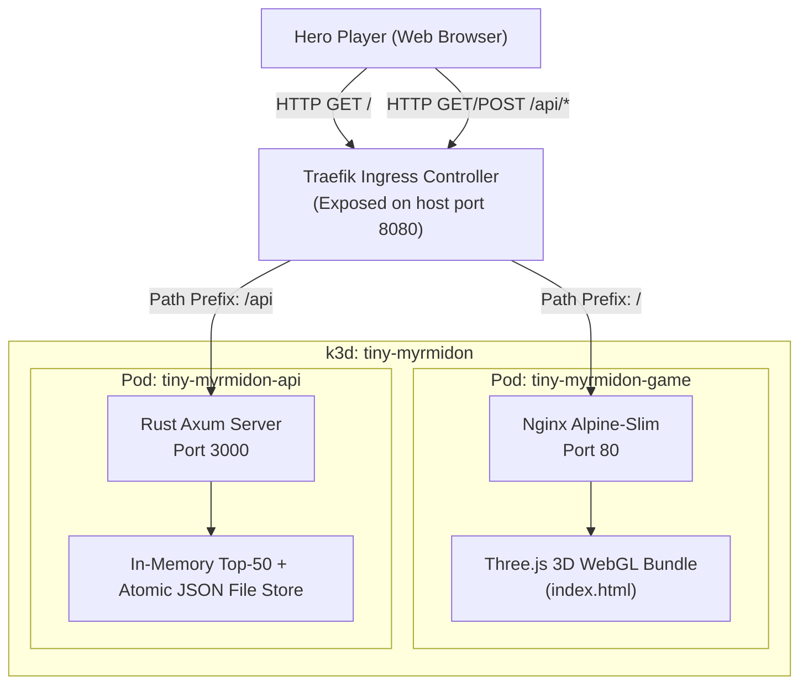

# Architecture & System Design

This document details the architectural blueprint, component interactions, and deployment model for **Tiny Myrmidon**.

---

## 1. High-Level Architecture Overview

Tiny Myrmidon is designed as a cloud-native, microservices-oriented application running on a local Kubernetes (`k3d`) cluster.



---

## 2. Component Breakdown

### 2.1. Frontend Game (`game/`)
* **Core Technology:** Three.js (r169) rendered via WebGL directly in modern browsers. The import map pins the CDN version and provides an integrity hash for the core module; the addon modules remain a runtime dependency on unpkg. The Nginx Content Security Policy allowlists that host for module loading while keeping API connections restricted to the same origin. A local bundle would remove the CDN availability dependency, but is deferred until the project adopts a frontend build/vendor workflow.
* **Architecture:**
  * Procedural circular arena bounded by 16 Doric Greek peristyle columns.
  * Deterministic tick-based game loop handling:
    * Player movement (WASD / Arrow Keys) with boundary clamping.
    * Autonomous spear targeting and projectile physics.
    * Enemy AI navigation (direct tracking towards hero coordinates).
    * Three enemy archetypes: Trojan Infantry, agile Harpies, and Cyclops Bosses.
    * Dynamic XP gem spawning, vacuum attraction, and Olympian blessing upgrades.
  * HTML5/CSS3 HUD and responsive modal overlays for level up and game over states.
  * Asynchronous REST communication via `fetch()` against `/api/scores`.
* **Container Runtime:** `nginx:alpine-slim` (~20.8 MB uncompressed, 5.8 MB content footprint).

### 2.2. Backend API (`api/`)
* **Core Technology:** Rust 2021 edition powered by the Axum web framework and Tokio asynchronous runtime.
* **Modular Code Structure:**
  * `main.rs`: Application bootstrap, structured environment logging initialization (`tracing`), and graceful shutdown listener.
  * `lib.rs`: Router definition (`create_app`), CORS configuration, and shared state encapsulation (`AppState`).
  * `models.rs`: Domain entities (`ScoreEntry`, `NewScore`), bounds validation rules, and unit tests.
  * `handlers.rs`: Request handlers for `/api/health` and `/api/scores` with contextual structured logs.
* **Concurrency Model:** Thread-safe top-50 state managed using `Arc<tokio::sync::RwLock<Vec<ScoreEntry>>>`. Score updates hold the write lock while an atomic JSON-file replacement completes; this deliberately keeps the file-backed deployment to one API replica.
* **Container Runtime:** Multi-stage build based on `rust:alpine` and minimal `alpine:3.20` base (~15 MB uncompressed, 4.3 MB content footprint). Stripped binary with Link-Time Optimization (`lto = true`).

---

## 3. Kubernetes Deployment Topology (`k8s/app.yaml`)

| Resource | Kind | Port / Target | Purpose | Probes |
| :--- | :--- | :--- | :--- | :--- |
| `tiny-myrmidon-game` | Deployment + Service | `80:80` | Serves static 3D game client | Default HTTP |
| `tiny-myrmidon-api` | Deployment + Service | `80:3000` | Leaderboard & health REST API | Liveness & Readiness on `/api/health` |
| `tiny-myrmidon-ingress` | Ingress (Traefik) | `8080:80` | Reverse proxy and unified routing | Native Traefik healthcheck |

---

## 4. Observability & Graceful Termination

1. **Structured Tracing:** All API transactions produce timestamped logs with trace targets:
   ```text
   2026-11-16T18:52:21.078Z INFO tiny_myrmidon_api: Server running on http://0.0.0.0:3000
   2026-11-16T18:52:31.102Z INFO tiny_myrmidon_api::handlers: Recorded new hero score player="Hercules" score=9999 wave=15
   ```
2. **Graceful Shutdown:** The Axum server traps `SIGINT` (Ctrl+C) and `SIGTERM` signals sent by Kubernetes during pod termination, allowing in-flight requests to complete before exiting.


## 5. Leaderboard persistence

The API can persist its sorted top-50 leaderboard to a JSON file through `SCORE_STORE_PATH`. Writes are serialized with the in-memory leaderboard lock, written to a temporary file, flushed with `fsync`, renamed into place, and followed by a parent-directory `fsync`. The Kubernetes deployment mounts a `ReadWriteOnce` local-path PVC at `/data`.

This intentionally supports one API replica. A file-backed volume is not a substitute for a shared transactional database: do not scale the API horizontally until the persistence layer has been replaced by PostgreSQL or another shared database.


## 6. Network boundary

The game and API NetworkPolicies accept ingress only from Traefik pods labelled `app.kubernetes.io/name=traefik` in the `kube-system` namespace. The API is configured for one trusted proxy hop; keep the setting aligned with the actual ingress chain if the topology changes.


## 7. Component boundaries and API contract

The repository has three deployable boundaries:

- **Game frontend (game/)** owns rendering, input, game state and presentation. It communicates with the backend only through the public HTTP endpoints; it does not import Rust code or access the persistence volume.
- **Leaderboard API (api/)** owns request validation, rate limiting, leaderboard ordering and persistence. Its Rust modules separate bootstrap, HTTP handlers, shared application state and domain models.
- **Deployment (k8s/, Dockerfiles and Nginx configuration)** owns container packaging, routing, network boundaries, resource limits and persistent-volume attachment. It consumes the frontend and API images rather than embedding application logic.

The HTTP boundary is documented in api.md and exercised by the API integration tests. The current contract is intentionally small: health, leaderboard reads and score submissions. The API schema is maintained manually rather than generated from OpenAPI, so changes to handlers must update the reference and its contract tests in the same change.

This is a clear separation of responsibilities, but not proof of complete independence. Changes to endpoint paths, payload fields, validation rules or deployment routing can still affect multiple components. Keep those contracts explicit and test both sides when they change.

## 8. Scaling, rate limiting and operational visibility

The API deployment intentionally runs one replica. Its rate limiter is process-local and its JSON store is attached to a single-writer ReadWriteOnce volume. Neither mechanism is shared between replicas. Do not increase the API replica count until the rate-limit state and leaderboard persistence have been moved to shared services (for example Redis and PostgreSQL).

The API currently emits structured request and application logs through tracing. It does not expose Prometheus metrics or ship with Grafana dashboards. For this small single-replica deployment, structured logs and Kubernetes resource limits remain the baseline; add metrics and alerting when operational needs justify a monitoring stack.

A dependency-free Node load probe is available at scripts/load-test.mjs. It exercises read-only leaderboard requests against a running deployment and reports latency percentiles and failures. It is a repeatable smoke/load probe, not a substitute for a production capacity test.
